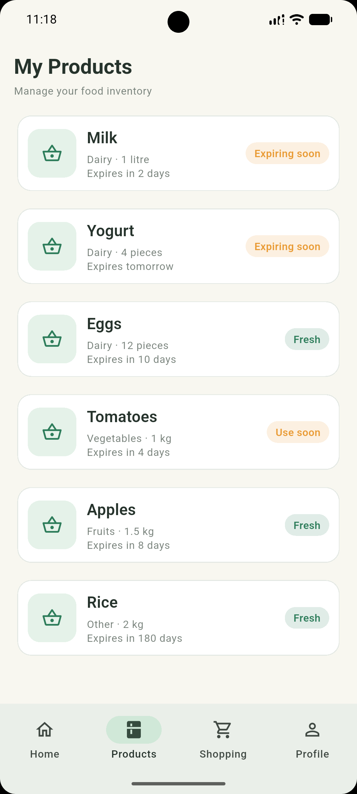
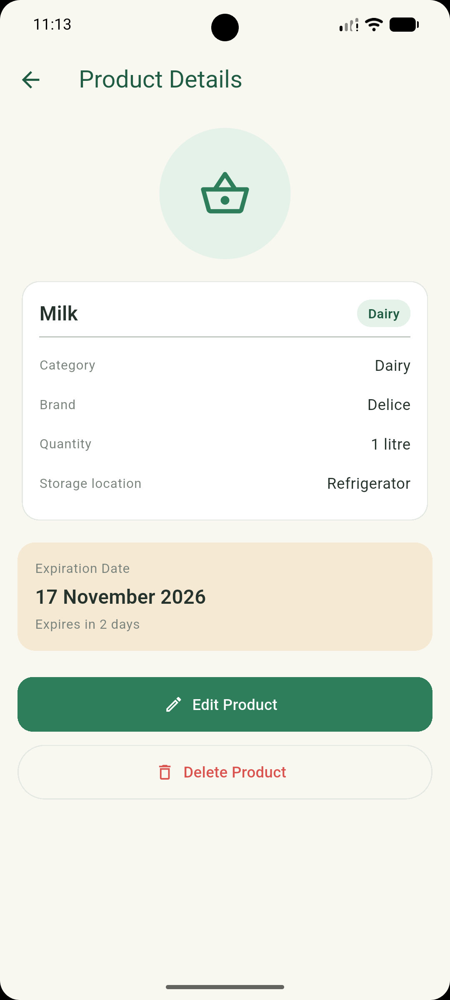
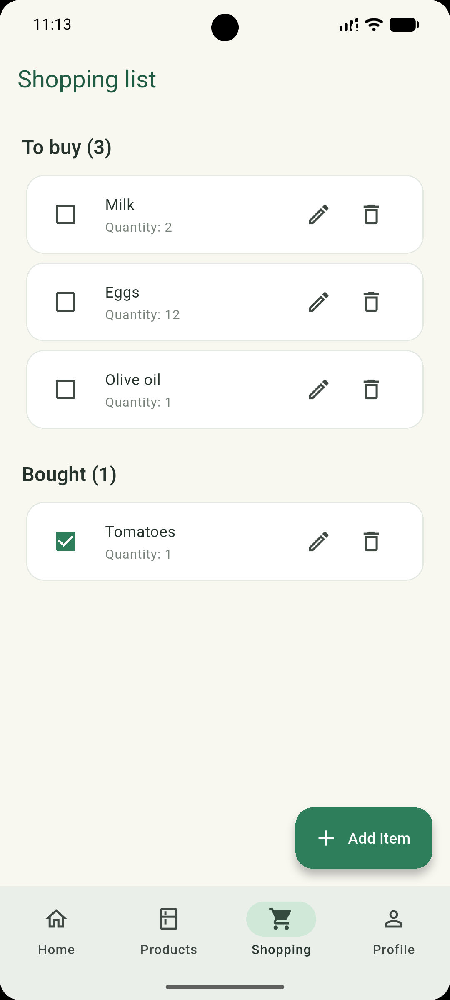

# smart_pantry

A new Flutter project.

## Jalon J1 : Squelette

Le squelette de l'application est terminé : les 6 écrans existent, la navigation fonctionne et les données passent de la liste au détail. Les données sont fictives pour l'instant (`lib/data/donnees_fictives.dart`).

### Captures d'écran

| Home | My Products | Product Details |
|---|---|---|
|  |  |  | 

| Add Product | Shopping List | Profile & Settings |
|---|---|---|
|  |  |  |

### Navigation

- Barre de navigation : Home ↔ My Products ↔ Shopping List ↔ Profile & Settings
- Home → Product Details (produit touché dans « Expiring Soon »)
- My Products → Product Details (produit touché dans la liste)
- Home → Add Product (bouton « Add Product »)
- Shopping List → Check (Product bought) → edit product name → delete product

Le produit touché est transmis à l'écran de détail par le constructeur : `ProductDetailsScreen(product: product)`.

### Répartition du travail

| Membre | Travail réalisé |
|---|---|
| Ahmed Wardi | Modèle `Product`, widgets `ProductCard` et `SectionTitle`, écrans Home, My Products et Product Details, données fictives |
| Youssef Saafi | Thème (`app_colors.dart`, `app_theme.dart`), modèle `ShoppingItem`, widgets `CustomButton` et `CustomTextField`, écrans Add Product, Shopping List et Profile, navigation |

### Exigences couvertes

- **EF1** : 6 écrans, dont une liste (My Products) et un détail (Product Details)
- **EF2** : navigation avec passage de données (liste → détail)

### Journale IA

- Journale Ahmed : https://share.gemini.google/brFqHRHfdxgc
- Journale Youssef : https://chatgpt.com/share/6afb6358-7b9c-83ea-9163-b2de919a9e98?ogimg=plain

## Jalon J2 : Données

### API utilisée

- **Open Food Facts** : https://world.openfoodfacts.org/ (documentation : https://openfoodfacts.github.io/openfoodfacts-server/api/)
- Données récupérées : nom, marque et image du produit. La quantité et la date de péremption sont saisies par l'utilisateur.
- Les erreurs (délai dépassé, pas de connexion, réponse invalide) sont converties en messages clairs par le service.

### Navigation et état partagé

- Home → Add Product et My Products → Add Product : le produit créé revient à l'écran appelant, qui l'ajoute à `InventoryProvider` avec `addProduct`.
- Product Details lit le produit à jour dans `InventoryProvider` grâce à son `id`. La quantité (+ et −) se modifie avec `copyWith` et `updateProduct`, la suppression demande une confirmation (`AlertDialog`) puis appelle `deleteProduct`.
- Home et My Products se mettent à jour automatiquement (`context.watch`) après un ajout, une modification ou une suppression.
- Product Details → Edit Product : formulaire prérempli ; le produit modifié revient à l'écran de détail (Navigator.pop) puis updateProduct met à jour l'état partagé.

### Manipulation guidée (C1)

Un exemple simple de `shared_preferences` : le nom du dernier produit consulté est sauvegardé (`lib/services/preferences_service.dart`) et affiché sur Home ("Last viewed") après un redémarrage de l'application. La persistance complète de l'inventaire et de la liste de courses est prévue pour J3 (EF7).

### Tests effectués (C2)

- Formulaire vide : les messages d'erreur s'affichent, rien n'est enregistré.
- Formulaire valide : le produit apparaît sur Home (Total Products) et sur My Products.
- Quantité + et − : mise à jour sur le détail et dans la liste.
- Suppression : annulation sans effet, confirmation qui retire le produit partout.
- Sans Internet : la recherche Open Food Facts affiche une erreur sans faire planter l'application, la saisie manuelle reste possible.
- Aucun débordement (bande jaune et noire) en portrait.

### Répartition du travail (J2)

| Membre | Travail réalisé |
|---|---|
| Ahmed Wardi | `Product` (id, imageUrl, copyWith), `InventoryProvider`, branchement de Home / My Products / Product Details, quantité et suppression avec confirmation, `OpenFoodFactsService` et `FoodInfo`, exemple `shared_preferences` |
| Youssef Saafi | Formulaire Add Product validé (EF3), retour du produit (EF4), `ShoppingProvider` branché sur Shopping List, bouton « Search with Open Food Facts » avec `FutureBuilder` |

### Journale IA

- Journale Ahmed : https://share.gemini.google/1PWvC42hIDQx
- Journale Youssef : https://chatgpt.com/share/6b087bc8-9ce4-83ea-8ea7-3de4eae55ce2

