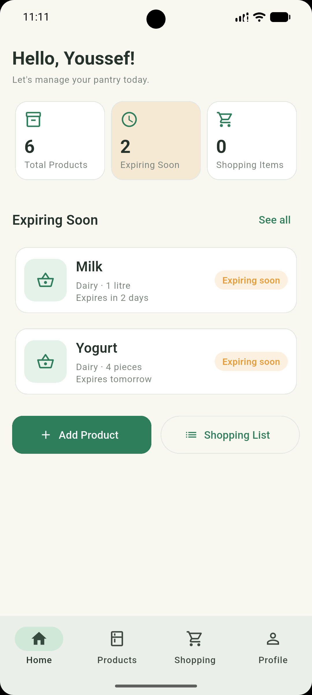
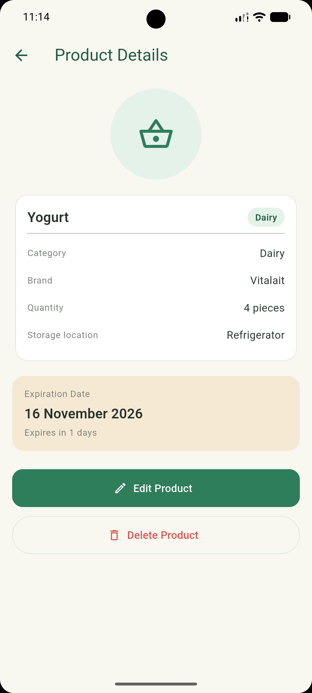
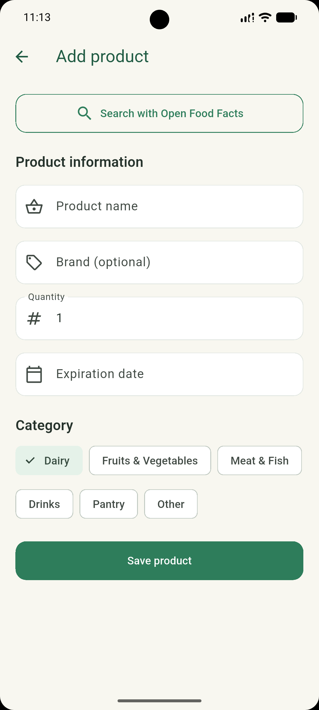
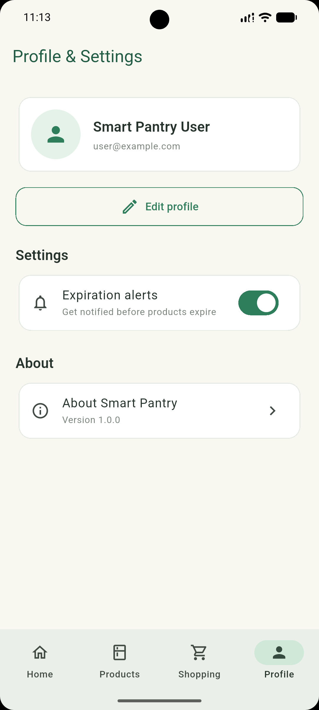

# smart_pantry

A new Flutter project.

## Jalon J1 : Squelette

Le squelette de l'application est terminé : les 6 écrans existent, la navigation fonctionne et les données passent de la liste au détail. Les données sont fictives pour l'instant (`lib/data/donnees_fictives.dart`).

### Captures d'écran

| Home | My Products | Product Details |
|---|---|---|
|  |  |  | 

| Add Product | Shopping List | Profile & Settings |
|---|---|---|
|  |  |  |

### Navigation

- Barre de navigation : Home ↔ My Products ↔ Shopping List ↔ Profile & Settings
- Home → Product Details (produit touché dans « Expiring Soon »)
- My Products → Product Details (produit touché dans la liste)
- Home → Add Product (bouton « Add Product »)
- Shopping List → Check (Product bought) → edit product name → delete product

Le produit touché est transmis à l'écran de détail par le constructeur : `ProductDetailsScreen(product: product)`.

### Répartition du travail

| Membre | Travail réalisé |
|---|---|
| Ahmed Wardi | Modèle `Product`, widgets `ProductCard` et `SectionTitle`, écrans Home, My Products et Product Details, données fictives |
| Youssef Saafi | Thème (`app_colors.dart`, `app_theme.dart`), modèle `ShoppingItem`, widgets `CustomButton` et `CustomTextField`, écrans Add Product, Shopping List et Profile, navigation |

### Exigences couvertes

- **EF1** : 6 écrans, dont une liste (My Products) et un détail (Product Details)
- **EF2** : navigation avec passage de données (liste → détail)

### Journale IA

- Journale Ahmed : https://share.gemini.google/brFqHRHfdxgc
- Journale Youssef : https://chatgpt.com/share/6afb6358-7b9c-83ea-9163-b2de919a9e98?ogimg=plain

